<p align="center">
  
</p>

# CredVault 🔐

**A zero-knowledge password vault for Android, iOS, the web and Windows.** Everything you save is encrypted on your device with a key made from your master password *before* it is sent to Firebase, so the server only ever holds scrambled data. CredVault also generates strong passwords, grades the health of your vault, and checks passwords against known data breaches without revealing them.

<p align="center">
  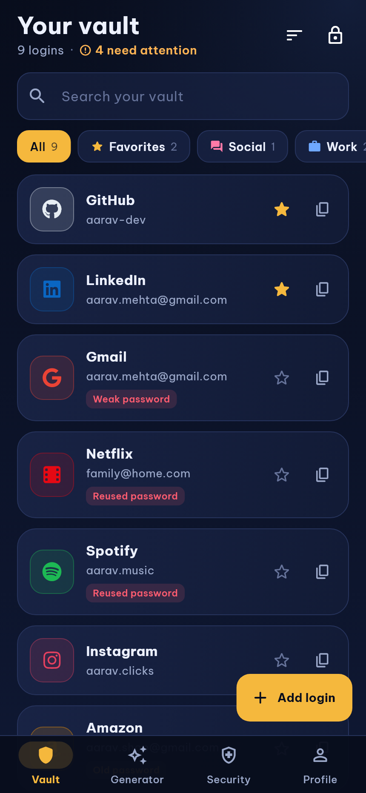
  &nbsp;
  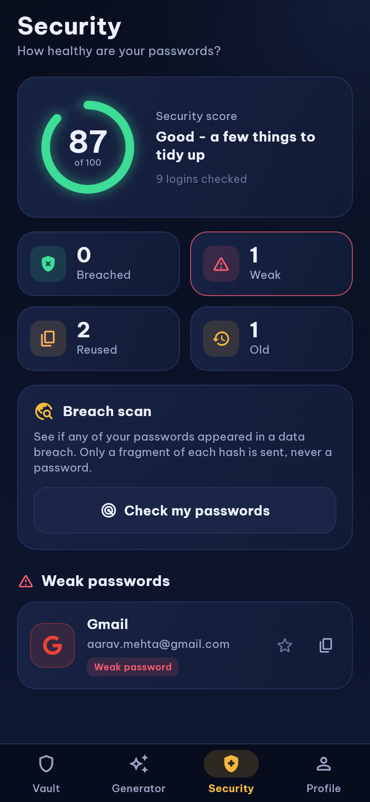
  &nbsp;
  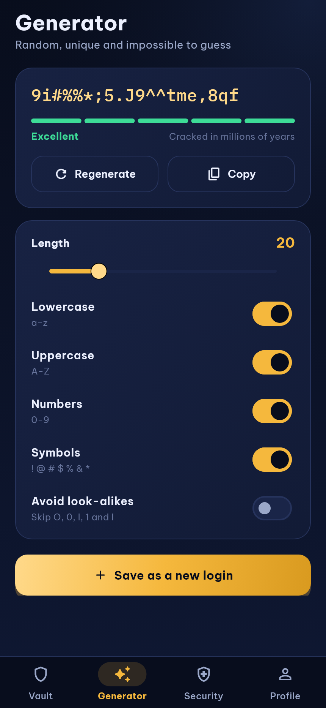
</p>

## 🎨 Logo and app icon

<p align="center">
  
</p>

A gold shield with a keyhole on midnight navy: your credentials, locked away safely. The same navy-and-gold palette runs through the whole app.

The logo is a 512 x 512 px image used on the app's screens and as the launcher icon on Android, iOS and the web (Android gets an adaptive icon). It is drawn by code, so it can be tweaked and regenerated:

```bash
pip install pillow numpy
python tool/generate_logo.py        # writes assets/images/*.png
dart run flutter_launcher_icons     # applies the launcher icons to every platform
```

| File | Size | Use |
| --- | --- | --- |
| `assets/images/logo.png` | 512 x 512 | README and in-app logo |
| `assets/images/launcher_icon.png` | 1024 x 1024 | iOS and legacy Android icon |
| `assets/images/launcher_foreground.png` / `launcher_background.png` | 1024 x 1024 | Android adaptive icon layers |

## ✨ Features

**Protecting your data**
- 🔒 **Zero-knowledge encryption** - AES-256-GCM, with the key derived from your master password (PBKDF2-HMAC-SHA256, 200,000 rounds, random salt). The master password is never stored or sent anywhere.
- 🔑 **Master-password lock** - unlock on every launch. The vault locks itself after the app has been in the background (immediately, 1, 5 or 15 minutes) and wipes decrypted data from memory.
- 📋 **Self-clearing clipboard** - copied passwords are wiped after 15 s, 30 s or 1 min (only if the clipboard still holds them).
- 👁️ **Passwords stay hidden** - revealing one hides it again after 20 seconds.
- 🚫 **No screenshots in release builds** on Android (and a blank recent-apps preview).
- 🗑️ **Real account deletion** - asks for your password, then removes your data and account.

**Using it**
- ⚡ **Password generator** - 8 to 64 characters, choose character types, skip look-alikes (`O`, `0`, `l`, `1`), with a live strength meter.
- 📊 **Security score** - finds weak, reused and old (180+ day) passwords, and gives the whole vault a 0 - 100 score.
- 🛰️ **Breach scan** - checks passwords against [Have I Been Pwned](https://haveibeenpwned.com/Passwords) using k-anonymity: only the first 5 characters of a SHA-1 hash are sent.
- 🗂️ **Organise** - 30+ services with brand icons, categories, favourites, notes, a custom name for anything else, search, and sorting (recent, A-Z, oldest, weakest).
- ↩️ **Undo** deleting a login.
- 🌐 **Open a saved website** straight from the login.
- 🔄 **Live sync** across devices, with offline support on phones.
- 🧱 **Master password change** that re-encrypts the whole vault.

## 📸 Screenshots

<table>
  <tr>
    <td align="center"><b>Sign in</b></td>
    <td align="center"><b>Create a vault</b></td>
    <td align="center"><b>Locked</b></td>
  </tr>
  <tr>
    <td>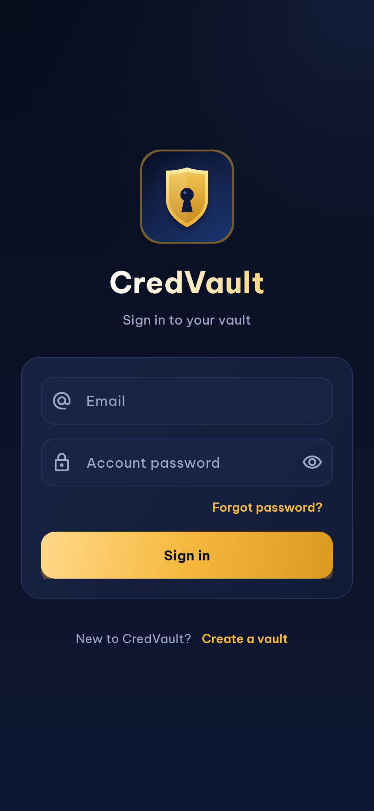</td>
    <td>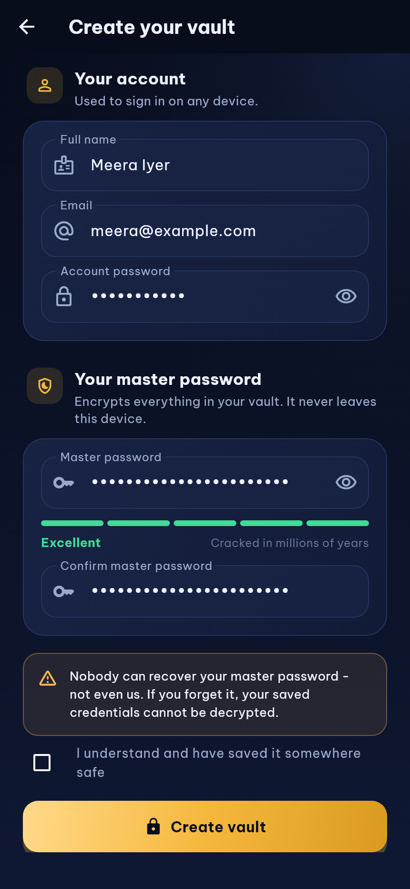</td>
    <td>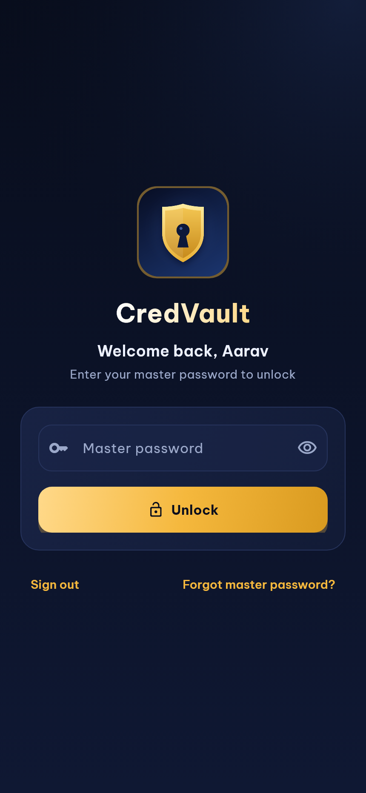</td>
  </tr>
  <tr>
    <td align="center"><b>Your vault</b></td>
    <td align="center"><b>Login details</b></td>
    <td align="center"><b>Password revealed</b></td>
  </tr>
  <tr>
    <td></td>
    <td>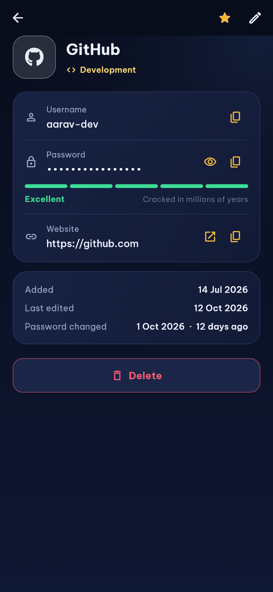</td>
    <td>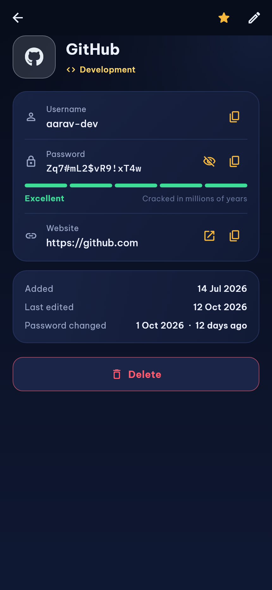</td>
  </tr>
  <tr>
    <td align="center"><b>Add a login</b></td>
    <td align="center"><b>Choose a service</b></td>
    <td align="center"><b>Generator</b></td>
  </tr>
  <tr>
    <td>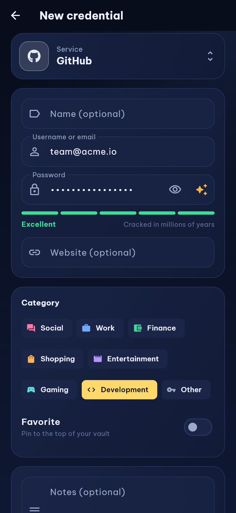</td>
    <td>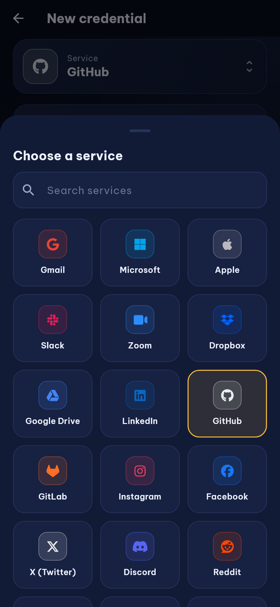</td>
    <td></td>
  </tr>
  <tr>
    <td align="center"><b>Security score</b></td>
    <td align="center"><b>Breach scan results</b></td>
    <td align="center"><b>Profile and settings</b></td>
  </tr>
  <tr>
    <td></td>
    <td>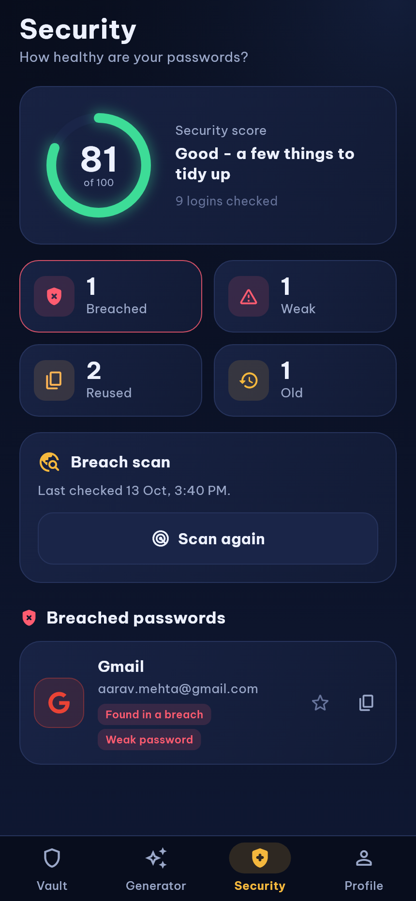</td>
    <td>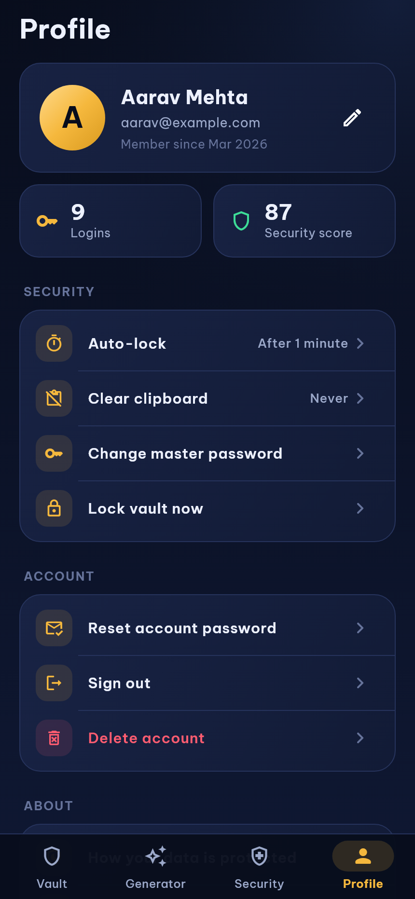</td>
  </tr>
</table>

### On the web and Windows

Phones keep the bottom navigation bar and single-column list. On wide windows (840 px and up) the app switches to a side navigation rail and a multi-column vault grid.

<p align="center">
  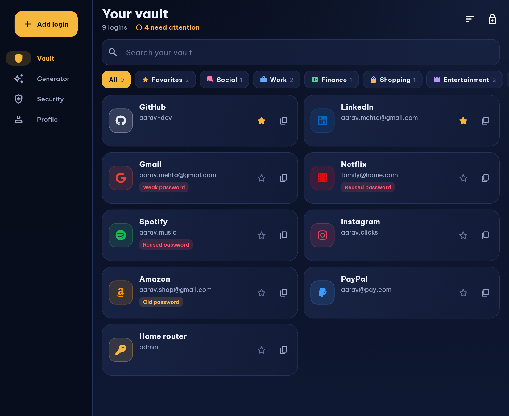
  &nbsp;
  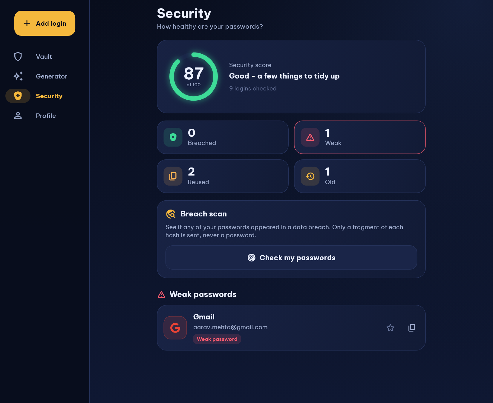
</p>

> The screenshots are generated from the real screens with made-up data (see [Regenerating the screenshots](#-regenerating-the-screenshots)), so they always match the current UI.

## 🛡️ How your data is protected

```
master password ──PBKDF2-HMAC-SHA256 (200k rounds, random salt)──▶ vault key (256-bit)
                                                                      │
 login (username, password, URL, notes, ...) ──AES-256-GCM, fresh nonce──▶ ciphertext ──▶ Firestore
```

| | What the server stores | Who can read it |
| --- | --- | --- |
| Credentials | One encrypted blob per login (service, username, password, URL, notes, category... all inside it) | Only someone with your master password |
| Vault settings | Random salt, iteration count, an encrypted check value | Not secret: they only let *your device* derive the key |
| Profile | Name, email, created date | You |
| Master password | **Nothing** | Only you |

- **Wrong password = nothing.** The check value is decrypted to verify the master password; a wrong one yields no key and no data.
- **Tampering is detected.** AES-GCM authenticates every record, so a modified record fails to decrypt instead of showing wrong data.
- **No recovery, by design.** If you forget the master password, nobody can decrypt your vault. You can erase the vault and start again (you will be asked for your account password).
- **Key stays in memory only** and is dropped when the vault locks.

**What this does not protect against:** malware on an unlocked device, someone who sees you type your master password, or a weak master password (the app rejects ones that are too easy to guess, but cannot make you choose a good one).

## 🚀 Getting started

### Prerequisites

- A current stable Flutter SDK (Dart 3.9 or newer, check with `flutter --version`)
- A Firebase project with **Authentication (Email/Password)** and **Cloud Firestore** enabled

### Setup

```bash
git clone <your-repo-url>
cd CredVault
flutter pub get

# Connect your own Firebase project (regenerates lib/firebase_options.dart
# and the platform config files)
dart pub global activate flutterfire_cli
flutterfire configure

flutter run                 # pick a device, or: flutter run -d chrome
flutter run -d windows      # Windows desktop app
```

### Firestore

**Collections**

| Path | Contents |
| --- | --- |
| `users/{uid}` | `name`, `email`, `createdAt`, and `vault` (`salt`, `iterations`, `verifier`, `legacyMigrated`) |
| `credentials/{id}` | `userId` (the Firebase uid), `v` (2), `data` (**encrypted**), `createdAt`, `updatedAt` |

**Index** - `credentials`: `userId` (ascending) + `createdAt` (descending). If it is missing, Firestore prints a link in the debug console that creates it.

**Security rules** (recommended):

```
rules_version = '2';
service cloud.firestore {
  match /databases/{database}/documents {

    match /users/{uid} {
      allow read, write: if request.auth != null && request.auth.uid == uid;
    }

    match /credentials/{id} {
      allow read, delete: if request.auth != null
                          && resource.data.userId == request.auth.uid;
      allow create: if request.auth != null
                    && request.resource.data.userId == request.auth.uid;
      allow update: if request.auth != null
                    && resource.data.userId == request.auth.uid
                    && request.resource.data.userId == request.auth.uid;
    }
  }
}
```

### Upgrading from version 1

Version 1 stored passwords **in plain text** and tagged them with a made-up id (`USER000012`). Version 2 migrates them automatically:

1. After signing in, an old account is asked to choose a **master password**.
2. On that first unlock, every old credential is encrypted and re-owned by your Firebase uid, and the plaintext is overwritten.

For the migration to read the old documents, add this temporary rule while users upgrade (it lets an owner read their own old records, identified through the old id kept in their profile). Remove it once everyone has migrated:

```
match /credentials/{id} {
  function ownsLegacy(data) {
    return exists(/databases/$(database)/documents/users/$(request.auth.uid))
        && get(/databases/$(database)/documents/users/$(request.auth.uid)).data.userId == data.userId;
  }
  allow read: if request.auth != null && ownsLegacy(resource.data);
  allow update: if request.auth != null && ownsLegacy(resource.data)
                && request.resource.data.userId == request.auth.uid;
}
```

> These migration rules are provided as a starting point and have not been run against a live Firestore project; test them first. If a credential cannot be read, it is simply skipped and retried at the next unlock.

### Platform notes

- **Android** - the `INTERNET` permission is declared for release builds, and links open through a package-visibility entry. In release builds the window is marked secure (no screenshots / recent-apps preview).
- **iOS / web** - no extra setup.

## 🗂️ Project structure

```
lib/
├── main.dart                     # Firebase init
├── app.dart                      # Providers, theme, auth/lock gate, auto-lock
├── core/
│   ├── crypto/vault_crypto.dart  # PBKDF2 + AES-256-GCM (the only crypto code)
│   ├── password/                 # Generator, strength estimator, breach checker
│   ├── security_report.dart      # Weak / reused / old / breached + score
│   └── validators.dart
├── models/                       # Credential, categories, platform catalog, vault metadata
├── providers/
│   ├── vault_provider.dart       # Lock state, decrypted items, CRUD, migration, master-password change
│   ├── credential_provider.dart  # Search / filter / sort state
│   └── auth_provider.dart        # Sign-in (interface + Firebase version)
├── services/                     # Firestore repository, settings, clipboard
├── screens/                      # Sign in, register, lock, vault, details, add/edit, generator, security, profile
├── widgets/                      # Cards, strength meter, security ring, pickers
├── theme/app_theme.dart          # Navy + gold design system
└── utils/open_url.dart
assets/fonts/                     # Be Vietnam Pro + IBM Plex Mono (SIL OFL licences included)
test/                             # Unit, service and widget tests, fakes, screenshot generator
tool/generate_logo.py             # Draws the logo and launcher icons
```

The screens depend only on interfaces (`VaultRepository`, `AuthProvider`, `BreachChecker`), which is why the whole app, including the encryption, can be tested and screenshotted without Firebase.

## ✅ Tests

```bash
flutter analyze
flutter test
```

130+ tests cover:

- **Encryption** - round trips (including Unicode), nonce uniqueness, wrong key, bit-flip tampering, key derivation, and that nothing readable is ever stored.
- **The vault** - lock/unlock, wrong master password, re-keying with a new master password, migrating plaintext from v1, undo, erasing the vault, and rolling back a half-created account.
- **Password tools** - generator guarantees, strength estimates, the security score and the breach check (verifying only a 5-character hash prefix is sent).
- **The UI** - sign-in, registration, lock screen, auto-lock (including that locking closes any open screen), searching and filtering, copy and reveal, add/edit/delete, the generator, the security tab and the profile (including account deletion).

## 🖼️ Regenerating the screenshots

The screenshot test is skipped in a normal `flutter test`. To refresh `docs/screenshots/`:

```bash
flutter test test/screenshots --dart-define=SCREENSHOTS=true
```

## 🔮 Ideas for later

- Biometric unlock (fingerprint / face) after the first master-password entry
- Autofill service for other apps and browsers
- Import and export (encrypted backup), 2FA code storage, secure notes
- Argon2id key derivation and a rising work factor over time
- Emergency access and shared vaults

---

Built with 💥 by DarkWizardCK
